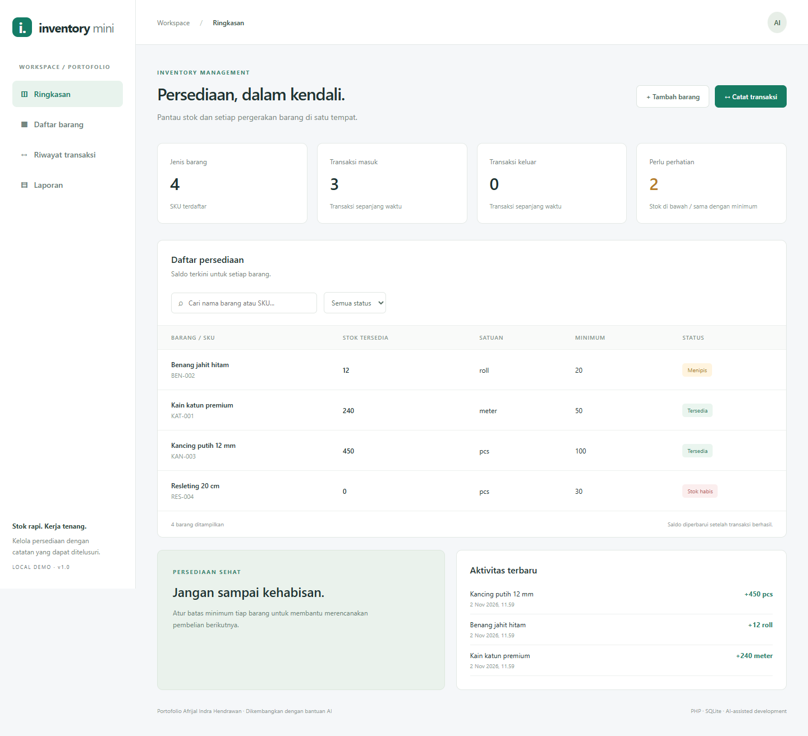

# Inventory Mini

A local inventory portfolio demo for small businesses, built for Afrijal Indra Hendrawan with AI assistance. Indonesian interface; persistent SQLite database; no external frontend dependencies.

## Preview



## Features
- Create products with a unique SKU, unit, and minimum-stock threshold.
- Record stock receipts and issues with references/notes.
- Reject withdrawals exceeding available stock, on the server.
- Keep a transaction ledger with the balance after each movement.
- Search products, filter low/zero stock, filter transactions by local calendar dates.
- Summarise receipts/issues per product and export CSV.
- Responsive desktop/mobile interface and optional fictional sample data.

## Run
Requires PHP 8.1+ with PDO SQLite and mbstring. No Composer or Node installation needed.

```sh
php -S 127.0.0.1:8094 -t public
```

Open http://127.0.0.1:8094. On Windows/XAMPP, replace `php` with `C:\xampp\php\php.exe` if needed. Select **Muat data contoh** on an empty inventory or add your own products. New products start at zero; add a receipt to establish their balance.

Data is stored at `storage/inventory.sqlite`, outside the public web root and excluded from Git. Stop the server before backing up that file. Set `INVENTORY_DB` to use a different file.

## Report semantics
Date filters affect incoming/outgoing quantities only. **Saldo terkini** always shows the current stock, not the historical closing balance for the selected period. Units are not combined into a misleading grand total. Timestamps are stored in UTC and shown in the browser's local time zone.

## Architecture and integrity
- `public/index.php`: page structure.
- `public/app.js`: UI state, filters, forms, and CSV export.
- `public/api.php`: JSON endpoints, validation, sessions, and database access.
- `public/style.css`: responsive styling.

Prepared statements protect database parameters. Writes require a session CSRF token. HTML output is escaped and exported cells neutralise spreadsheet formula prefixes. SQLite `BEGIN IMMEDIATE` serialises stock changes; stock and ledger updates commit together. Database constraints also prohibit negative balances.

## Tests and portfolio evidence
See [test results](docs/TEST-RESULTS.md), [AI development record](docs/AI-DEVELOPMENT.md), and [screenshots](docs/).

API tests require an **empty, isolated database**. In another terminal, set `INVENTORY_DB` to a fresh file and start a test server on port 8095, then run:

```sh
python tests/test_api.py http://127.0.0.1:8095
```

Choose a fresh test database for each run; the suite deliberately refuses non-empty inventories.

## Scope
Single-user local portfolio demo. No authentication, role-based permissions, product editing/deletion, pricing, or production deployment is included. Do not expose this PHP development server to the internet or use real confidential business data. This demo is not the private Tugas Kita or FILIO PIUM codebase.

Before presenting the project, the owner should run it and be able to explain requirements, validation, transaction consistency, and the testing evidence. AI assistance does not imply unaided authorship of every line.

